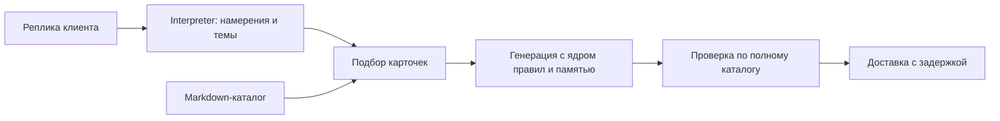

# Правила Марко: хранение, подбор и QMD

После сравнительного прогона по запросу владельца локальный каталог обновлён до 2026-10-15.1: добавлена обязательная CORE.IDENTITY для эксперимента удержания человеческой роли с информированным тестировщиком. В текущем каталоге 18 карточек. Числа 17 и результаты QMD ниже относятся к измеренной версии .4; её индекс намеренно несовместим с новой версией. Проект изменения: `identity-experiment-design-2026-10-15.md`. На сервер эксперимент не выпущен.

## Что делает каждый компонент

Каталог — источник текста правил. Python и QMD — два способа выбрать из него нужные карточки. LLM получает выбранные инструкции и пишет ответ. Сам QMD не пишет реплики Марко, не проверяет их достоверность и не исправляет доставку Telegram.

| Способ | Как выбирает | Зависимости | Ограничение |
|---|---|---|---|
| Полный пакет | Передаёт все 17 карточек | Только каталог | Больше текста на каждый ход |
| Python | Сопоставляет topics и серверное состояние с conditions карточек | Interpreter уже выполнен, дополнительного LLM-запроса нет | Ошибка темы может пропустить ситуационную карточку |
| QMD BM25 | Ищет слова в проиндексированных Markdown-карточках | Локальный индекс и CLI | Совпадение слов не гарантирует нужного смысла |
| QMD hybrid | Совмещает лексический и векторный поиск, затем переранжирует кандидатов | Индекс, embeddings, локальные модели | Задержка и память больше, чем у поиска по словам |

Векторный поиск сравнивает числовые представления смысла. Переранжирование отдельно оценивает пары «запрос — найденная карточка» и меняет порядок результатов. Обычный `qmd query` также может расширять запрос локальной моделью; измеренный SDK-прототип использует явные lex+vec запросы без расширения. Повтор запроса из кеша нужно измерять отдельно от нового поиска.

Документация: [официальный репозиторий QMD](https://github.com/tobi/qmd). В опыте использована версия 2.8.3.

## Как работает текущий Python-путь

Interpreter выдаёт `policy_topics`, область recall, запросы времени и другие структурированные признаки. `RuleSelector` выбирает карточки по их `conditions`, добавляет зависимости и обязательное ядро. При неизвестной ситуации используется полный пакет. Пользовательские границы передаются в контексте и обязательны всегда. Валидатор получает полный каталог, чтобы обнаружить нарушение даже при пропуске карточки генератором.

Например, `contact` выбирает правило тёплой границы общения; `recall` — правило воспоминания, включая детей и питомца. Это сопоставление не требует второго запроса к модели. При этом качество Interpreter всё равно важно: Python не угадывает пропущенное намерение сам.

## Как подключён экспериментальный QMD

Индекс содержит только 17 активных карточек выбранной версии, без клиентских сообщений и секретов. Результаты поиска проверяются по ID, версии и SHA256 каталога. За ход разрешён один запрос, таймаут — 1 секунда. Ошибка, пустая выдача или несовпадение версии возвращают полный пакет. Обязательное ядро, время, recall, follow-up и commerce по серверным признакам не зависят исключительно от выдачи поиска.

В QMD 2.8.3 лексические слова соединяются через AND. Поэтому свободное описание intent вместе со всеми темами оказалось плохим поисковым запросом: на реальных диалогах выдача была пустой. Исправленный BM25-прототип ищет одну тематическую метку из conditions каталога; для общей беседы — `conversation`. Это ограниченный поиск, всё ещё зависящий от Interpreter. Не следует переносить его результаты на все возможные варианты QMD.

При изменении каталога нужно обновить версию и manifest, создать новый изолированный индекс и повторить проверку. Изменение Markdown без обновления индекса не обновляет поисковую выдачу автоматически в этом прототипе. В рабочем приложении QMD пока не включён.

## Где теперь редактировать инструкции

| Содержание | Источник |
|---|---|
| Характер, разговорные действия, границы, recall, время, стиль | `app/policies/catalog.md` |
| Контракты Interpreter, генератора, валидатора, памяти, summary, follow-up, recovery и платформенных этапов | `app/policies/contracts/*.md` |
| Проверенные короткие примеры | `app/policies/examples.json` |
| Готовые фразы для фото, времени, activity recovery и исправления приветствия | `app/policies/responses.json` |
| Стабильная биография персонажа и разрешения раскрытия, без изменений в этой итерации | `app/modules/agent/persona.py` |
| Сборка этих ресурсов | `app/modules/agent/prompts.py`, `resources.py` |

Контракты этапов загружаются напрямую. Инструкция вернуть корректную JSON-схему не должна случайно исчезнуть из-за нерелевантного поиска. Ресурсы кешируются внутри процесса, поэтому после их изменения нужен перезапуск приложения. Сроки, отмена, захваты, доставка, регулярные выражения проверок и JSON-схемы остаются кодом: это исполняемая логика, а не разговорные промпты.

Удалено конфликтовавшее с каталогом правило из языкового валидатора: «при общем recall только одна характерная деталь». Текст о семье и питомце теперь определяется каталогом, а не противоречащим ему вторым правилом.

## Два разных значения fallback

**Fallback подбора** — передать полный каталог, когда поиск не сработал. Он сохраняется независимо от будущего выбора QMD.

**Fallback ответа** — готовая фраза для узкого детерминированного случая. Эти фразы перенесены из Python в JSON, но их поведение сохранено. QMD не заменяет такой механизм: при недоступной LLM найденная карточка не превращается в ответ. Удаление этих ответов означало бы отдельное изменение поведения, которое нужно проверять отдельно от сравнения поиска. Общей технической заглушки «попробуйте ещё раз» не добавлено.

## Как читать метрики

`selections` показывает время поиска, ID, причину выбора, размер пакета и fallback. `runs[].metrics.llm_events` показывает этап, модельную задержку, очередь и токены. `validation_events` сохраняет причины отклонений и исправления. `transcript` содержит фактически доставленные в тестовый отправитель части.

Сравниваем отдельно покрытие нужными карточками и качество готового ответа. Правильная карточка не гарантирует соблюдения правила моделью. Автоматический оценщик на той же модели тоже может ошибаться, поэтому его флаги не называются «точностью». Задержка модели, искусственная пауза набора и Telegram-транспорт — разные измерения.
